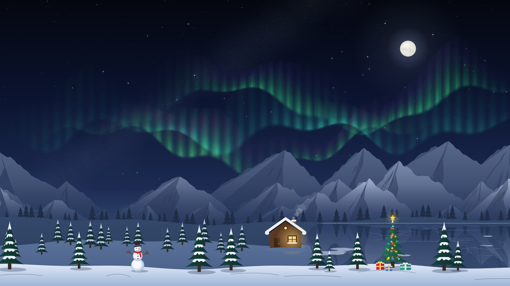

# Winter Theme

A Christmas-themed GNOME Shell extension:

- **Falling snow** that piles up on the top edge of windows (shake a window to knock it off).
- **A full-screen winter scene** in place of the wallpaper: mountains, a frozen lake with reflections, pines, a cabin, a snowman and a twinkling Christmas tree. It follows the light and dark style. At night there are a moon, stars, animated northern lights and the odd shooting star.
- **Snow on idle monitors:** with several monitors, the one you are not using slowly fills with snow, which melts away when you move the pointer back.
- **A Christmas countdown** in Quick Settings.
- **Sleigh-bell notification sounds** (off by default).

Everything can be switched on and off from the Winter tile in Quick Settings or from the preferences.

Built for GNOME Shell 51 (Fedora 45, Wayland).




## Install

```sh
git clone <this repo> && cd Winter_Theme
make install
```

Log out and back in, then `make enable` (or `gnome-extensions enable winter-theme@zeroze01`). Settings: `gnome-extensions prefs winter-theme@zeroze01`.

## Development

See `CLAUDE.md` for architecture and the headless preview workflow (`make preview`, `make scene`, `make test`).
